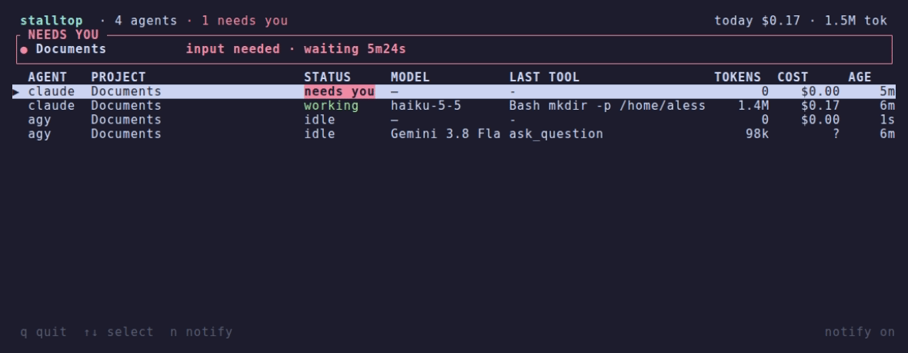

# StallTop

**htop for your AI coding agents**



You started four agents in four terminals. One has been waiting for you to approve `npm run build`, for nearly 20 minutes. Another hit its usage limit an hour ago and will sit there until you notice. 
StallTop lists every live AI coding agent session (Claude Code, Codex CLI, Gemini CLI, Antigravity CLI) on your machine, shows what each one is doing and what it costs, and **puts the ones that need you on top**.

- **Needs you**: a session is waiting on a permission or has a question blocking the entire thread
- **Rate-limited**: a session hit a usage limit. You see the reset time and a countdown
- **Quiet**: a session says it is busy but has not written anything for 5 mins
- Cost is an API-equivalent estimate (Gemini cost: unknown for newer models)
  - [Gemini Billings](https://aistudio.google.com/docs/billing)
  - [Codex Billings](https://www.google.com/goto?url=CAESYwHEIkXXibF8sUcSjCu4ssPthF72O9u4PZMbo-9Pk3QQcZraKUJUZvJCoi7FOFzMN2aTwy0lGhoeMWGp1e5Nv3bq7EGAlw-3sVq1dvWIcE9hYbUSqQp32HdVgceEDOiF072E5w&gsessionid=p3EEoo9uF1oOTnreNBTPk2-hRnzZxLxfqGilmEtGEDrt_IpwAxGDww)
  - [Claude Billings](https://www.google.com/goto?url=CAESaQHEIkXXa3nQDcOX_wHCQXqkus6tOMRs2PWhYwngRplXYLEg5iHVtQ2slwDAS3_tq1ec9tZnhs_J_OB2sNLUseemm1nUUW-IQ3jzxA6Thox9ZbpCvVw1v24b_tuqJn_ZUh5EbIkX-c9_bQ&gsessionid=r86_2fvSECRpziaKl-WLeL6gG3A2XudVt9fzwqdvfYakcyLxMnD4vw)
- A desktop notification and a terminal bell when a session starts needing you

The `AGENT` column tells you which tool owns each session. All agents are shown in one list.

It only reads the files your agents already write on your disk. Nothing to configure, nothing to install inside your agent, no network access.

## Supported agents
| Agent       | Status                                          |
|-------------|-------------------------------------------------|
| Claude Code | full: tokens, cost, permission and limit alerts |
| Gemini CLI  | tokens, cost, working / idle / ended            |
| Codex CLI   | tokens, cost, working / idle / ended (beta)     |
| Antigravity | tokens, working / idle / ended                  |


## Install

Linux only for now (x86_64)

Download the latest binary from the [Releases page](https://github.com/AlessioFerrari8/StallTop/releases/latest), then make it executable and put it in your `PATH`:

```sh
chmod +x stalltop
sudo mv stalltop /usr/local/bin/
stalltop
```

### Build from source

Requires Rust 1.88 or newer.

```sh
git clone https://github.com/AlessioFerrari8/StallTop.git
cd StallTop
cargo install --path .
```

## Use

    stalltop          # live view
    stalltop --once   # print one snapshot and exit

Keys: `↑` `↓` / `k` `j` select, `q` / `Esc` / `Ctrl-C` quit, `n` toggles notifications.
Flags: `--interval <ms>` (default 1000), `--no-notify`, `--no-bell`, `--home <dir>`, `--once`.

## Roadmap

Opencode, Grok CLI, windows and macOS

## License

MIT
