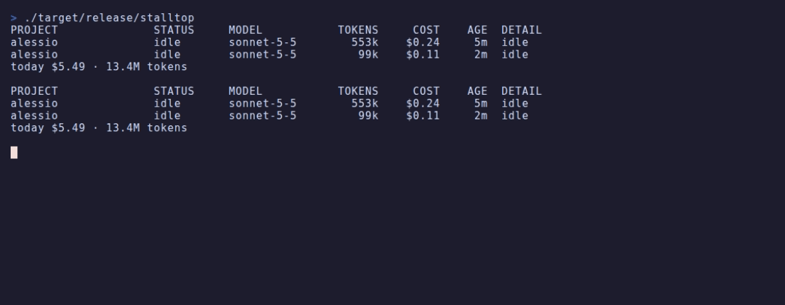

# StallTop

**htop for your AI coding agents**



You started four agents in four terminals. One has been waiting for you to approve `npm run build`, for nearly 20 minutes. Another hit its usage limit an hour ago and will sit there until you notice. 
StallTop lists every live Claude Code session on your machine, shows what each one is doing and what it costs, and **pits the ones that need you on top**.

- **Needs you**: a session is waiting on a permission or a question
- **Rate-limited**: a session hit a usage limit. You see the reset time and a countdown
- **Quiet**: a session says it is busy but has not written anything for 5 mins
- Tokens and API-equivalent cost per session

It only reads the files Claude Code already writes on your disk. Nothing to configure, nothing to install inside Claude Code, no network access.


## Install

Download the latest binary from the [Releases page](https://github.com/AlessioFerrari8/StallTop/releases/latest), then make it executable and put it in your `PATH`:

```sh
chmod +x stalltop
sudo mv stalltop /usr/local/bin/
stalltop
```

### Build from source

Requires Rust 1.88 or newer.

```sh
git clone https://github.com/AlessioFerrari8/StallTop.git
cd StallTop
cargo install --path .
```

## Use

    stalltop          # live view
    stalltop --once   # print one snapshot and exit

Keys: `↑` `↓` / `k` `j` select, `q` / `Esc` / `Ctrl-C` quit.
Flags: `--interval <ms>` (default 1000), `--home <dir>`, `--once`.

## Roadmap

Desktop notifications, Gemini CLI, Codex CLI, Agy

## License

MIT